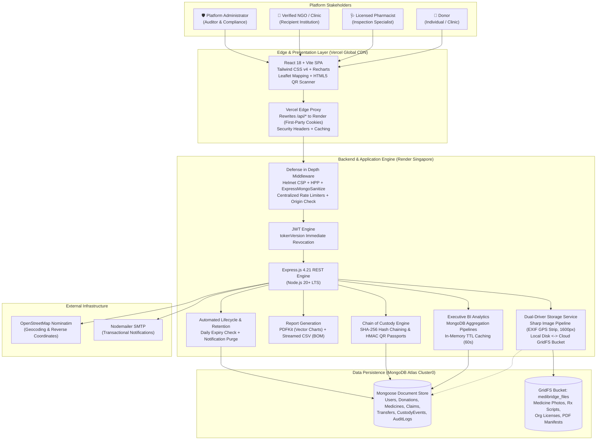

# 🏥 MediBridge

<div align="center">

**Enterprise Medicine Donation, Pharmacist Verification & Cryptographic Redistribution Network**

A secure, technology-driven redistribution ecosystem connecting donors, licensed healthcare professionals, and verified non-profit institutions to safely reallocate sealed, unexpired medicines with zero tampering risk.

<br />

<!-- 20+ Production Badges -->
[](https://github.com/kasimshah19/MediBridge/actions/workflows/ci.yml)
[](https://opensource.org/licenses/MIT)
[](https://nodejs.org/)
[](https://react.dev/)
[](https://vitejs.dev/)
[](https://expressjs.com/)
[](https://www.mongodb.com/cloud/atlas)
[](https://tailwindcss.com/)
[](https://medi-bridge-taupe.vercel.app)
[](https://medibridge-5n0o.onrender.com)
[](https://jwt.io/)
[-FF6B6B)](https://www.npmjs.com/package/bcryptjs)
[](https://zod.dev/)
[](https://leafletjs.com/)
[](https://en.wikipedia.org/wiki/Cryptographic_hash_function)
[](https://en.wikipedia.org/wiki/HMAC)
[](https://sharp.pixelplumbing.com/)
[](https://getpino.io/)
[](https://recharts.org/)
[](https://playwright.dev/)

<br />

[Live Application](https://medi-bridge-taupe.vercel.app) • [API Service](https://medibridge-5n0o.onrender.com) • [System Health](https://medibridge-5n0o.onrender.com/api/health/ready) • [Documentation](docs/ARCHITECTURE.md)

</div>

---

## 🌐 Live Deployments & Endpoints

| Tier | Environment | Platform | URL / Connection | Status |
| :--- | :--- | :--- | :--- | :--- |
| **Client Frontend** | Production | **Vercel** | [https://medi-bridge-taupe.vercel.app](https://medi-bridge-taupe.vercel.app) |  |
| **REST API Server** | Production | **Render (Singapore)** | [https://medibridge-5n0o.onrender.com](https://medibridge-5n0o.onrender.com) |  |
| **Readiness Probe** | Production | **Render** | [https://medibridge-5n0o.onrender.com/api/health/ready](https://medibridge-5n0o.onrender.com/api/health/ready) |  |
| **Database & GridFS**| Production | **MongoDB Atlas** | `Cluster0 (Cloud Managed Replica Set)` |  |

> **Security Note:** Raw database connection credentials and URIs are securely maintained in production environment configurations and are never committed to version control.

---

## 💡 Problem Statement vs. MediBridge Solution

```
┌─────────────────────────────────────────────────────────────┐
│                     THE HEALTHCARE PARADOX                  │
│                                                             │
│   Billions of Rupees in sealed, unexpired medicines are    │
│   discarded annually into landfills, while marginalized      │
│   patients suffer from critical medication shortages.       │
└──────────────────────────────┬──────────────────────────────┘
                               │
            ┌──────────────────┴──────────────────┐
            ▼                                     ▼
┌───────────────────────────────┐   ┌───────────────────────────────┐
│     TRADITIONAL BARRIERS      │   │     MEDIBRIDGE SOLUTION       │
├───────────────────────────────┤   ├───────────────────────────────┤
│ • Counterfeits & Tampering    │   │ • Pharmacist Quality Gate     │
│ • Expired Drug Toxicity       │   │ • Automated Safety Screening  │
│ • No Traceability or Audit    │   │ • SHA-256 Custody Hash Chain  │
│ • Complex Regulatory Hurdles  │   │ • Digital HMAC-SHA256 QR Pass │
│ • Logistical Mismatches       │   │ • 2dsphere Geo-Radius Match   │
│ • Privacy Leaks & Doxxing     │   │ • Strict PII Stripping Policy │
└───────────────────────────────┘   └───────────────────────────────┘
```

### 1. The Real-World Challenge
- **Excessive Medical Wastage:** Families and clinics routinely purchase full medicine strips or bottles, only to have excess treatments sit unused in medicine cabinets until they expire.
- **Counterfeit & Tampering Vulnerability:** Traditional donation drives cannot reliably guarantee whether a donated medicine was stored properly, opened, compromised, or swapped with counterfeit stock.
- **Severe Liability Concerns:** Non-profit charities and clinics cannot legally accept blind medicine donations without qualified pharmacist verification and proof of provenance.

### 2. The MediBridge Innovation
- **Multi-Tier Automated Screening:** Submissions instantly screen packaging integrity, rule out banned or high-risk therapeutic classes, and reject any items expiring within 30 days.
- **Licensed Pharmacist Quality Gate:** Professional verification queue with atomic 1-hour claim locks, a 6-point physical/regulatory inspection checklist, and clarification communication loops.
- **Tamper-Proof Custody Ledger:** Every transition (Submission -> Screening -> Verification -> Matching -> Handover -> Transfer) writes an immutable event cryptographically bound to the previous event via SHA-256 hash chaining.
- **Physical Handover Safeguards:** Transfer between Donor and NGO requires a single-use 15-minute rolling code (`HND-XXXXXX`) and a mandatory 4-point physical receipt verification.
- **Full Privacy Protection:** Strips donor phone numbers, email addresses, exact street addresses, and photo GPS coordinates (EXIF) across all public traces and review queues.

---

## 🏛️ System Architecture



---

## 🛠️ Complete Technology Stack

| Layer | Technology | Purpose & Implementation |
| :--- | :--- | :--- |
| **Frontend Framework** | **React 18.3 + Vite 6.4** | High-performance Single Page Application with fast HMR and optimized chunking |
| **Styling & Design** | **Tailwind CSS v4** | Modern healthcare UI token system (Teal `#0D9488`, Sky `#0EA5E9`), glassmorphism |
| **Animation & UX** | **Framer Motion 12** | Fluid page transitions, collapsible drawers, and toast alerts |
| **Charts & BI** | **Recharts 2.15** | Area charts, stacked bars, conversion funnels, and inventory forecasting |
| **Geospatial Mapping** | **Leaflet + OpenStreetMap** | Interactive donation discovery, 2dsphere radius visualization, and geocoding |
| **QR Code Engine** | **qrcode + html5-qrcode** | High-density SVG/PNG QR generation and real-time mobile camera scanner |
| **Backend Runtime** | **Node.js 20+ LTS** | Asynchronous, event-driven RESTful micro-service engine |
| **API Framework** | **Express.js 4.21** | Route handlers, centralized error wrappers (`asyncHandler`), and controllers |
| **Database** | **MongoDB Atlas + Mongoose 8** | Schematized document store with indexes (`2dsphere`, compound, TTL) |
| **Cloud File Storage** | **MongoDB GridFS (`medibridge_files`)** | Stateless, scalable chunked storage for photos, verification documents, and licenses |
| **Image Pipeline** | **Sharp 0.33** | Auto-rotation, EXIF GPS stripping, 1600px dimensional clamping, JPEG q80 encoding |
| **Authentication** | **JWT + bcryptjs (12 rounds)** | Cookie-based session tokens with `tokenVersion` immediate invalidation |
| **Schema Validation** | **Zod 3.24** | Type-safe input validation across all API boundaries |
| **Security Headers** | **Helmet 8 + HPP** | Strict CSP, HSTS, cross-origin resource isolation, and parameter pollution defense |
| **Structured Logging** | **Pino + Pino-HTTP** | High-throughput JSON logging with automatic PII and credential redaction |
| **Compliance Reports** | **PDFKit + json2csv** | Vector-rendered A4 platform reports and streamed CSV exports with Excel BOM |
| **Testing & Quality** | **Jest + Supertest + Playwright** | 17 integration test suites (169 tests) and cross-browser end-to-end specs |

---

## 👥 Core Personas & Feature Capabilities

```
  DONOR                      PHARMACIST                   NGO & CLINICS               ADMINISTRATOR
┌───────────────────────┐  ┌───────────────────────┐  ┌───────────────────────┐  ┌───────────────────────┐
│ • Easy Multi-Item Add │  │ • Priority Queue View │  │ • Post Medicine Needs │  │ • Executive BI KPIs   │
│ • Auto-Screen Status  │  │ • 1-Hour Claim Lock   │  │ • Geo-Matched Items   │  │ • User Account Gov    │
│ • Track Verifications │  │ • 6-Point Checklist   │  │ • 48-Hour Reservation │  │ • Instant Token Kill  │
│ • Rolling Handover OTP│  │ • Clarification Loops │  │ • Physical Inspection │  │ • Masked Audit Trail  │
│ • Printable Labels PDF│  │ • Issue QR Passports  │  │ • Handover Receipt PDF│  │ • Vector PDF / CSV Rep │
└───────────────────────┘  └───────────────────────┘  └───────────────────────┘  └───────────────────────┘
```

### 1. 👤 The Donor
- **Streamlined Multi-Medicine Submission:** Batch submit up to 10 medicines with brand names, batch numbers, dosage forms, quantities, and clear packaging photos.
- **Real-Time Automated Screening:** Instant feedback on shelf-life (> 30 days mandatory), sealed condition check, and banned substance exclusion.
- **Interactive Verification Timeline:** Live visibility into review status, assigned pharmacist first name, and clarification inquiries.
- **Rolling Handover Token:** Generate single-use, 15-minute dynamic pass codes (`HND-XXXXXX`) to authorize physical release.
- **Printable 2x4 Medicine Labels:** Download official A4 label sheets with batch numbers and QR stamps to attach to medicine boxes.

### 2. 🩺 The Licensed Pharmacist
- **Triage & Queue Management:** Filter unassigned items by urgency (`CRITICAL`, `URGENT`, `NORMAL`) and therapeutic class.
- **Atomic Concurrency Locks:** Locking an item prevents review collisions by holding a 60-minute claim lease with lazy-expiry takeover.
- **6-Point Professional Inspection:**
  1. Packaging intact, sealed, and untampered
  2. Expiry date clearly legible and > 30 days remaining
  3. Batch number conforms to manufacturer syntax
  4. Ambient storage conditions compliant
  5. Zero physical discoloration, dampness, or structural deformation
  6. Genuine manufacturer labeling and registration
- **Digital Passport Issuance:** Approval cryptographically signs an HMAC-SHA256 token and issues an immutable custody block.

### 3. 🏢 The Verified NGO / Charitable Clinic
- **Demands & Requirements Registry:** Broadcast current community medicine needs with target quantities and priority ratings.
- **Geospatial Proximity Matching:** Automated discovery of verified medicine reserves within 5 km, 10 km, or 20 km radii.
- **48-Hour Reservation Hold:** Lock matched medicines to coordinate transportation and pickup logistics.
- **4-Point Physical Receipt Inspection:** On-site verification of sealed status, batch alignment, physical condition, and temperature integrity.
- **Official Handover Manifest (PDF):** Instant download of signed redistribution receipts bearing ledger SHA-256 hash prefixes.

### 4. 🛡️ The Platform Administrator
- **Executive Real-Time Analytics:** 11 KPI metrics with period-over-period trend percentages, donation conversion funnels, rejection root-cause analysis, and 12-month expiry risk projections.
- **User Governance & Instant Session Revocation:** Suspend or block compromised accounts with a mandatory audit reason. Revocation increments `tokenVersion`, invalidating tokens on the very next HTTP request.
- **Privacy-Compliant Audit Log:** Full activity audit viewer with masked client IPs (`103.21.54.xxx`) and secure CSV exports.
- **Automated Data Retention:** Scheduled cron job automatically purges read notifications older than 90 days.

---

## 🔒 Security Architecture & Defensive Controls

### 1. Cryptographic Chain of Custody Formula
Every state change writes an append-only event to the `CustodyEvent` collection. Events are cryptographically chained using SHA-256:

$$H_0 = \text{"GENESIS"}$$

$$H_n = \text{SHA-256}\Big(H_{n-1} \mathbin{\Vert} \text{"|"} \mathbin{\Vert} \text{canonicalJSON}(\text{payload})\Big)$$

- **Deterministic Serialization:** `canonicalJSON` recursively sorts all object keys lexicographically and converts Date objects to ISO-8601 UTC strings.
- **Runtime Immutability:** Mongoose middleware intercepts `save`, `updateOne`, `findOneAndUpdate`, and `deleteOne` to block modifications to historical custody events.

### 2. Digital Passport Authenticity (HMAC-SHA256)
Approved medicines receive a verifiable QR token signed with the server's private secret:

$$\text{Token} = \text{HMAC-SHA-256}(\text{medicineId}, \text{QR\_SIGNING\_SECRET})[:32]$$

Public verification validates the token using constant-time evaluation (`crypto.timingSafeEqual`) to protect against timing side-channel attacks.

### 3. Media Sanitization Pipeline (EXIF GPS Stripping)
Uploaded photos pass through a non-bypassable Sharp processing pipeline:
- Auto-orients image based on orientation tag
- **Strips all EXIF metadata**, irreversibly removing embedded GPS latitude and longitude coordinates
- Downscales long dimensions exceeding 1600px
- Re-compresses to clean JPEG quality 80

### 4. Formula Injection Defense (CSV Injection)
All administrative CSV report exports neutralize spreadsheet formula execution:
- Any cell beginning with `=`, `+`, `-`, `@`, or `\t` is automatically prefixed with a single quote (`'`), preventing Excel or Google Sheets from executing command formulas upon opening.

### 5. Centralized Rate Limiting Matrix

| Rate Limiter | Scope | Window | Threshold | Action on Exceed |
| :--- | :--- | :--- | :--- | :--- |
| **Global API** | Per IP Address | 15 Minutes | 300 Requests | 429 Too Many Requests |
| **Authentication** | Per IP Address | 1 Hour | 20 Requests | 429 with `Retry-After` Header |
| **File Uploads** | Per Authenticated User | 15 Minutes | 30 Requests | 429 with Upload Lock |
| **Admin Analytics** | Per Admin Account | 1 Minute | 120 Requests | 429 with Cached Fallback |
| **PDF/CSV Reports** | Per Admin Account | 1 Hour | 20 Requests | 429 with Resource Notice |

---

## 📁 Repository Directory Structure

```
MediBridge/
├── .github/
│   └── workflows/
│       ├── ci.yml                 # Automated Test & Build CI Pipeline
│       └── expiry-check.yml       # Daily Expiry & Notification Cron
├── backend/
│   ├── src/
│   │   ├── config/                # Database, rate limits, env validation
│   │   ├── controllers/           # Route controllers (Auth, Analytics, Reports, etc.)
│   │   ├── middleware/            # Auth, RBAC, originCheck, error handler
│   │   ├── models/                # Mongoose schemas (User, Donation, Custody, etc.)
│   │   ├── routes/                # Express API route modules
│   │   ├── scripts/               # Migration, seeding, and security check scripts
│   │   ├── services/              # Business logic (Storage, Analytics, Custody, QR)
│   │   ├── utils/                 # ApiError, ApiResponse, Pino logger, tokens
│   │   ├── validators/            # Zod input validation schemas
│   │   ├── app.js                 # Express application configuration
│   │   └── server.js              # Server bootstrapper & socket listener
│   ├── tests/                     # 17 Jest integration test suites (169 tests)
│   ├── package.json
│   └── render.yaml                # Render Blueprint deployment configuration
├── frontend/
│   ├── public/
│   │   ├── robots.txt             # Search engine crawling rules
│   │   └── sitemap.xml            # Public routes sitemap
│   ├── src/
│   │   ├── api/                   # Axios client & scoped API modules
│   │   ├── components/            # Layout, UI components, ErrorBoundary, Banners
│   │   ├── context/               # AuthContext & global application state
│   │   ├── hooks/                 # usePageMeta, useCountUp, useDebounce
│   │   ├── pages/                 # Role-based dashboard views & public pages
│   │   ├── routes/                # AppRoutes & protected route guards
│   │   ├── utils/                 # Indian numbering & IST date formatting
│   │   ├── App.jsx                # Application root with providers & banners
│   │   └── main.jsx               # React DOM entry point
│   ├── package.json
│   ├── vercel.json                # Vercel proxy & security headers
│   └── vite.config.js             # Vite configuration with chunk splitting
├── docs/
│   ├── ARCHITECTURE.md            # Detailed system diagrams & state machines
│   ├── SECURITY.md                # Comprehensive threat model & crypto decisions
│   └── DEMO.md                    # 5-minute evaluator demonstration script
├── e2e/                           # Playwright cross-browser test suite
├── DEPLOY.md                      # Step-by-step production deployment manual
└── README.md                      # Root documentation
```

---

## ⚙️ Environment Variables Reference

### Backend Configuration (`backend/.env`)

| Variable | Requirement | Default | Description |
| :--- | :--- | :--- | :--- |
| `NODE_ENV` | Optional | `development` | Runtime environment (`development`, `production`, `test`) |
| `PORT` | Optional | `5000` | Port for Express HTTP listener |
| `MONGODB_URI` | **Required** | — | MongoDB Atlas SRV connection string |
| `CLIENT_URL` | **Required** | `http://localhost:5173` | Allowed frontend origin for CORS & cookie credentials |
| `JWT_SECRET` | **Required** | — | Secret string for signing auth tokens (min 32 chars in prod) |
| `CRON_SECRET` | **Required** | — | Secret header token for scheduled jobs (min 24 chars in prod) |
| `QR_SIGNING_SECRET`| **Required** | — | HMAC-SHA256 secret for digital QR passports (min 32 chars) |
| `STORAGE_DRIVER` | Optional | `local` (dev) / `gridfs` (prod)| File persistence driver (`local` disk or MongoDB `gridfs`) |
| `TRUST_PROXY_HOPS` | Optional | `2` | Reverse proxy hop count for real client IP extraction |
| `ANALYTICS_CACHE_SECONDS` | Optional | `60` | In-memory TTL cache duration for executive analytics |
| `REPORT_MAX_ROWS_CSV` | Optional | `5000` | Maximum rows streamed in administrative CSV exports |
| `REPORT_MAX_ROWS_PDF` | Optional | `500` | Maximum rows rendered in PDF platform tables |
| `NOTIFICATION_RETENTION_DAYS` | Optional | `90` | Days to retain read notifications before automated purge |
| `LOG_LEVEL` | Optional | `info` | Logging verbosity (`error`, `warn`, `info`, `debug`) |

### Frontend Configuration (`frontend/.env`)

| Variable | Requirement | Default | Description |
| :--- | :--- | :--- | :--- |
| `VITE_API_URL` | **Required** | `/api` | Base API path (proxied to Render backend via Vercel rewrite) |

---

## 🚀 Local Installation & Quick Start

### 1. Prerequisites
- **Node.js**: `v20.0.0` or higher
- **npm**: `v10.0.0` or higher
- **MongoDB**: Local MongoDB instance or free MongoDB Atlas cluster

### 2. Clone the Repository
```bash
git clone https://github.com/kasimshah19/MediBridge.git
cd MediBridge
```

### 3. Backend Setup
```bash
cd backend
npm install

# Copy environment template and configure secrets
cp .env.example .env

# Seed initial system administrator
npm run seed:admin

# Start development API server
npm run dev
```

### 4. Frontend Setup
```bash
cd ../frontend
npm install

# Start Vite development server
npm run dev
```

Open [http://localhost:5173](http://localhost:5173) in your browser.

---

## 🧪 Testing & Verification Suite

MediBridge includes complete test suites across unit, integration, and security layers.

```bash
# 1. Run all 17 backend integration test suites (169 tests)
cd backend
npm test

# 2. Run repository security and secret hygiene verification
npm run security:check

# 3. Cryptographically audit all custody hash chains in the database
npm run custody:verify

# 4. Verify clean frontend production compilation
cd ../frontend
npm run build
```

---

## ⚖️ Regulatory Compliance & Medical Disclaimer

> **Mandatory Disclaimer:** MediBridge is a software and technology research demonstration platform. MediBridge does not manufacture, prescribe, or sell pharmaceutical products. All redistribution operations must comply strictly with the **Drugs and Cosmetics Act, 1940**, the **Drugs and Cosmetics Rules, 1945**, and relevant local health authority directives. The platform strictly prohibits open strips, loose tablets, unsealed bottles, injections, scheduled narcotics, and cold-chain medications.

---

## 📄 License & Intellectual Property

Distributed under the **MIT License**. See `LICENSE` for details.

Developed with ❤️ for equitable, transparent, and technology-driven healthcare redistribution.
