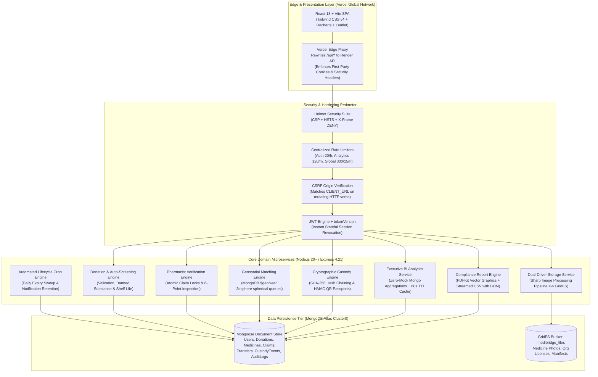
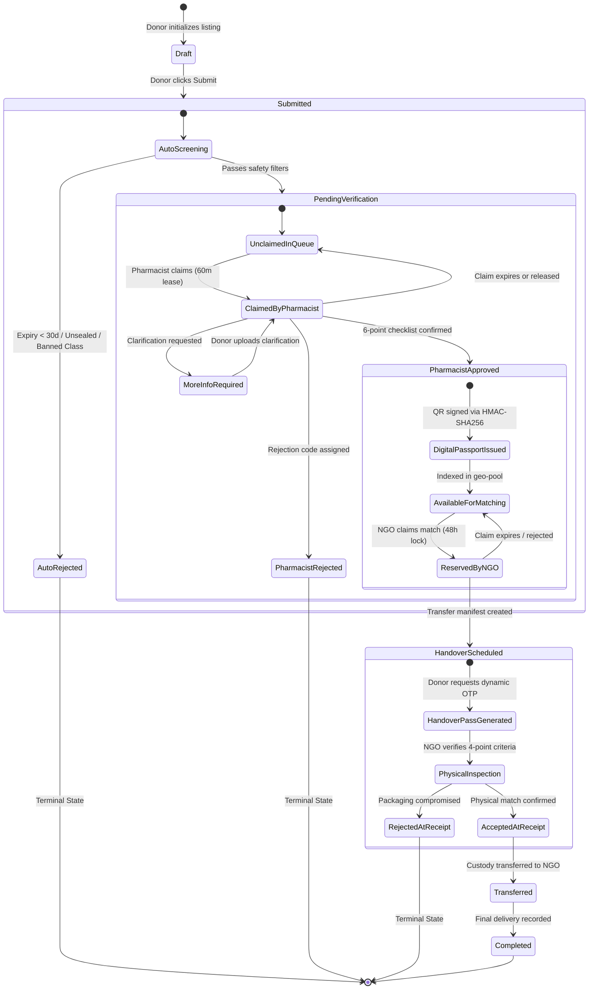

# 🏥 MediBridge — Complete Technical Specification & Documentation

<div align="center">

**Enterprise-Grade Medicine Donation, Quality Verification & Cryptographic Chain of Custody Network**

*Bridging the gap between surplus healthcare resources and underserved communities through licensed pharmacist verification, geospatial matching, and immutable cryptographic tracking.*

<br />

<!-- Comprehensive 22+ Production Badges -->
[](https://github.com/kasimshah19/MediBridge/actions/workflows/ci.yml)
[](https://opensource.org/licenses/MIT)
[](https://nodejs.org/)
[](https://react.dev/)
[](https://vitejs.dev/)
[](https://expressjs.com/)
[](https://www.mongodb.com/cloud/atlas)
[](https://tailwindcss.com/)
[](https://medi-bridge-taupe.vercel.app)
[](https://medibridge-5n0o.onrender.com)
[](https://jwt.io/)
[-FF6B6B)](https://www.npmjs.com/package/bcryptjs)
[](https://zod.dev/)
[](https://leafletjs.com/)
[](https://en.wikipedia.org/wiki/Cryptographic_hash_function)
[](https://en.wikipedia.org/wiki/HMAC)
[](https://sharp.pixelplumbing.com/)
[](https://getpino.io/)
[](https://recharts.org/)
[](https://playwright.dev/)
[-brightgreen)](https://jestjs.io/)
[](https://www.mongodb.com/docs/manual/core/gridfs/)

<br />

[Explore Live Web App](https://medi-bridge-taupe.vercel.app) • [Backend API Service](https://medibridge-5n0o.onrender.com) • [System Health Probe](https://medibridge-5n0o.onrender.com/api/health/ready) • [Architecture Guide](docs/ARCHITECTURE.md) • [Security Whitepaper](docs/SECURITY.md)

</div>

---

## 📑 Table of Contents
1. [Executive Summary & Core Mission](#-executive-summary--core-mission)
2. [Live Deployments & Infrastructure Grid](#-live-deployments--infrastructure-grid)
3. [The Healthcare Paradox: Problem vs. Solution](#-the-healthcare-paradox-problem-vs-solution)
4. [System Architecture & Lifecycle Workflows](#-system-architecture--lifecycle-workflows)
5. [Cryptographic Engineering & Security Architecture](#-cryptographic-engineering--security-architecture)
6. [Geospatial Proximity Matching & Spherical Algorithms](#-geospatial-proximity-matching--spherical-algorithms)
7. [Dual-Driver Storage & Image Pipeline](#-dual-driver-storage--image-pipeline)
8. [Executive Real-Time Analytics & BI Engine](#-executive-real-time-analytics--bi-engine)
9. [Detailed Technology Stack Matrix](#-detailed-technology-stack-matrix)
10. [Role-Based Feature Capabilities](#-role-based-feature-capabilities)
11. [Data Model & Database Schema Design](#-data-model--database-schema-design)
12. [Complete RESTful API Endpoint Catalog](#-complete-restful-api-endpoint-catalog)
13. [Directory Tree & Codebase Layout](#-directory-tree--codebase-layout)
14. [Environment Variables Reference](#-environment-variables-reference)
15. [Local Installation & Development Guide](#-local-installation--development-guide)
16. [Testing, E2E & Quality Verification](#-testing-e2e--quality-verification)
17. [Cold-Start Mitigation & Reliability](#-cold-start-mitigation--reliability)
18. [Phase-by-Phase Implementation History](#-phase-by-phase-implementation-history)
19. [Statutory Compliance & Legal Disclaimer](#-statutory-compliance--legal-disclaimer)

---

## 🎯 Executive Summary & Core Mission

Every year, billions of rupees worth of perfectly usable, sealed, and unexpired medicines are incinerated or discarded into municipal landfills. Concurrently, millions of low-income families and under-resourced charitable clinics struggle with chronic shortages of vital medications. 

**MediBridge** addresses this public health crisis by establishing a trust-minimized, technology-driven redistribution ecosystem. By combining **automated pharmaceutical screening**, **mandatory quality reviews by licensed pharmacists**, **geospatial proximity matching**, and a **cryptographically linked SHA-256 chain of custody**, MediBridge ensures that every single redistributed medicine strip is safe, genuine, legally compliant, and traceable down to its physical handover.

---

## 🌐 Live Deployments & Infrastructure Grid

The MediBridge platform is deployed across a multi-cloud serverless and edge infrastructure:

| Component | Platform | Region | Endpoint / Host | Health & Status |
| :--- | :--- | :--- | :--- | :--- |
| **Frontend Web App** | **Vercel** | Global Edge CDN | [https://medi-bridge-taupe.vercel.app](https://medi-bridge-taupe.vercel.app) |  |
| **Backend REST API** | **Render** | Singapore (`ap-southeast-1`) | [https://medibridge-5n0o.onrender.com](https://medibridge-5n0o.onrender.com) |  |
| **Readiness Probe** | **Render** | Singapore | [https://medibridge-5n0o.onrender.com/api/health/ready](https://medibridge-5n0o.onrender.com/api/health/ready) |  |
| **System Uptime Probe**| **Render** | Singapore | [https://medibridge-5n0o.onrender.com/api/health](https://medibridge-5n0o.onrender.com/api/health) |  |
| **Database & GridFS**| **MongoDB Atlas** | AWS Mumbai (`ap-south-1`) | `Cluster0 (Cloud Managed Replica Set)` |  |

> 🔒 **Security Notice:** For production security, database connection URIs, cryptographic keys, and master SMTP credentials are strictly isolated within environment variable key vaults and are never exposed in client bundles or public repositories.

---

## 💡 The Healthcare Paradox: Problem vs. Solution

### 1. The Multi-Faceted Crisis: Why Medicine Redistribution Fails Today

In India and across developing healthcare ecosystems, a profound structural contradiction persists: **billions of rupees worth of unexpired, life-saving medicines are discarded into waste bins daily, while marginalized patients perish or slip into crippling poverty due to the unaffordability of identical treatments.**

```
┌──────────────────────────────────────────────────────────────────────────────────────────────────┐
│                               THE HEALTHCARE ASYMMETRY PROBLEM                                  │
├─────────────────────────────────────────────────┬────────────────────────────────────────────────┤
│             SURPLUS & WASTAGE SECTOR            │             DEFICIT & SHORTAGE SECTOR          │
├─────────────────────────────────────────────────┼────────────────────────────────────────────────┤
│ • ₹12,000+ Crores discarded annually in India   │ • 55M+ people pushed into poverty by drug costs│
│ • Fixed blister packs force over-purchasing     │ • 70% of out-of-pocket health costs are drugs  │
│ • Patients discontinue medication early         │ • Primary Health Centers (PHCs) face stockouts │
│ • Discarded antibiotics breed superbugs (AMR)   │ • Chronic patients skip essential daily doses  │
│ • Zero safe, structured channels to donate      │ • Charitable clinics rely on uncertain supply │
└─────────────────────────────────────────────────┴────────────────────────────────────────────────┘
```

#### 1.1 The Macro-Economic Wastage & Over-Dispensing Trap
Pharmaceutical manufacturers package medicines in standardized blister strips (typically 10, 14, or 15 tablets/capsules). However, outpatient clinical regimens frequently require non-standard durations (e.g. 3, 5, or 7 days). Consequently, patients are legally required to purchase excess volume. 

When symptoms subside or when physicians alter prescriptions due to intolerance or adverse effects, the remaining 50% to 70% of the blister pack sits dormant in household medicine cabinets. Eventually, these medicines pass their expiration date and are discarded into municipal trash. Nationally, this accounts for an estimated economic waste exceeding **₹12,000 Crores annually** in India alone.

#### 1.2 Catastrophic Out-of-Pocket Expenditure (OOPE) & Stockouts
According to World Health Organization (WHO) and National Sample Survey Office (NSSO) datasets:
- **Out-of-Pocket Burden:** Nearly **70% of all out-of-pocket health expenditure in India is spent exclusively on retail pharmaceutical drugs**.
- **Impoverishment:** Over **55 million citizens are pushed below the poverty line every single year** solely due to catastrophic medication costs.
- **Rural Supply Failure:** Public Primary Health Centers (PHCs) and Community Health Centers (CHCs) frequently experience acute supply-chain stockouts for essential maintenance drugs: antihypertensives, oral hypoglycemics (metformin, glimepiride), cardiac therapeutics (statins, beta-blockers), and broad-spectrum antibiotics.

#### 1.3 The Counterfeit, Substandard & Tampering Threat
The pharmaceutical secondary market is inherently high-risk. WHO estimates indicate that in low- and middle-income countries, **over 1 in 10 pharmaceutical products are substandard or falsified**. 
- **Physical Adulteration:** Unsealed bottles, opened syrup containers, and split blister foils are susceptible to environmental moisture, microbial contamination, chemical degradation, or malicious tampering.
- **Degradation Toxicity:** Certain degraded pharmaceuticals (such as degraded tetracyclines or degraded penicillins) transform into nephrotoxic or hepatotoxic compounds capable of causing acute Fanconi syndrome or systemic organ failure.

#### 1.4 Ecological Hazards & Antimicrobial Resistance (AMR)
When households dispose of leftover pharmaceuticals, the standard practice is flushing them down toilets or throwing them into open municipal landfills:
- **Groundwater Contamination:** Active Pharmaceutical Ingredients (APIs) bypass conventional sewage treatment plants, seeping into surface water tables and irrigation canals.
- **Antimicrobial Resistance (AMR) Proliferation:** Sub-therapeutic concentrations of broad-spectrum antibiotics (such as azithromycin, ciprofloxacin, and amoxicillin) lingering in water reservoirs exert immense selective pressure on aquatic bacteria, directly accelerating the emergence of pan-drug-resistant "superbugs"—a declared global public health emergency.

#### 1.5 Legal Liabilities & Regulatory Deadlocks
Under the **Drugs and Cosmetics Act, 1940** and the **Drugs and Cosmetics Rules, 1945**, the sale, distribution, and stocking of scheduled prescription drugs (Schedule H, Schedule H1, and Schedule X) are governed by strict licensing provisions. 
- **Strict Liability on NGOs:** Legitimate NGOs, charitable clinics, and non-profit hospitals cannot legally or ethically accept random, blind donations of loose medicines from the public. If a donated medicine causes an Adverse Drug Reaction (ADR) or toxicity due to improper prior storage or tampering, the receiving institution faces criminal prosecution, license revocation, and immense civil liability.
- **The "No Provenance" Roadblock:** Without a verifiable, immutable record proving where a medicine originated, how long it was held, and who verified its physical integrity, regulated health institutions are legally forced to reject community donations.

#### 1.6 The Failure of "Dead-End Donation Boxes"
Traditional attempts at medicine collection have failed due to fundamental logistical flaws:
- **Passive Drop Boxes:** Placement of passive collection bins in apartment lobbies or public temples leads to unmonitored stockpiles exposed to high ambient humidity, direct sunlight, and heat (frequently exceeding 40°C in Indian summers), irreversibly destroying thermo-sensitive active compounds.
- **Logistical Asymmetry:** Centralized sorting warehouses face massive courier and freight bills attempting to transport low-value small strips across cities, making traditional redistribution economically unviable.

---

### 2. The MediBridge Paradigm: Comprehensive Technological & Operational Solution

MediBridge solves this structural crisis by replacing blind, risky donations with a **zero-trust, multi-tiered digital redistribution protocol** governed by automated pharmaceutical screening, certified human experts, mathematical provenance tracking, and geospatial proximity matching.

```
┌──────────────────────────────────────────────────────────────────────────────────────────────────┐
│                             THE MEDIBRIDGE 5-TIER REDISTRIBUTION PROTOCOL                        │
├──────────────────────────────────────────────────────────────────────────────────────────────────┤
│                                                                                                  │
│   [ 1. AUTOMATED SCREENING ]  ──►  Instant 30-day shelf-life floor + Banned Drug Blacklist       │
│                │                                                                                 │
│                ▼                                                                                 │
│   [ 2. PHARMACIST QUALITY GATE ] ──► Mandatory 6-point clinical inspection + 60-min claim lock    │
│                │                                                                                 │
│                ▼                                                                                 │
│   [ 3. CRYPTOGRAPHIC PROVENANCE] ──► Immutable SHA-256 hash-chained ledger + HMAC QR passport    │
│                │                                                                                 │
│                ▼                                                                                 │
│   [ 4. GEOSPATIAL PROXIMITY ] ──► 2dsphere spherical matching within 5-20km + 48-hr reserve lock │
│                │                                                                                 │
│                ▼                                                                                 │
│   [ 5. SECURE PHYSICAL HANDOVER] ──► 15-min rolling OTP (HND-XXXXXX) + 4-point physical receipt  │
│                                                                                                  │
└──────────────────────────────────────────────────────────────────────────────────────────────────┘
```

#### 2.1 Tier 1: Automated Pharmaceutical Pre-Screening Engine
Before a donation can even enter the review workflow, MediBridge executes a deterministic, multi-point rule engine:
- **30-Day Mandatory Shelf-Life Ceiling:** Any medicine expiring within 30 days is **blocked instantly** at submission time. The system calculates remaining shelf-life against Indian Standard Time (`Asia/Kolkata`).
- **Regulatory Substance Blacklist:** Automatically screens and rejects:
  - Banned Fixed-Dose Combinations (FDCs) declared unsafe by the Central Drugs Standard Control Organisation (CDSCO).
  - Schedule X Habit-Forming Narcotics and Psychotropics.
  - Strict Cold-Chain Formulations (insulin, monoclonal antibodies, biologics requiring unbroken 2°C–8°C storage).
  - Open liquid syrups, unsealed ointments, and loose unblistered tablets.
- **Sealed-Packaging Enforcement:** Donors must submit high-resolution photographic proof demonstrating intact manufacturer blister foil, unbroken seals, and legible batch numbers.

#### 2.2 Tier 2: Licensed Pharmacist Quality Assurance Gate (Human-in-the-Loop)
Software rules alone cannot evaluate physical drug integrity. MediBridge enforces mandatory review by certified healthcare professionals:
- **Credential Verification:** Only pharmacists with validated state pharmacy council registration numbers and licensed pharmacy affiliations can access the review queue.
- **Atomic 60-Minute Review Locks:** To prevent review collisions in high-concurrency environments, when a pharmacist opens an item, an atomic distributed lock leases the item for 60 minutes. Other pharmacists see the item as locked, with lazy-expiry takeover if abandoned.
- **Standardized 6-Point Inspection Checklist:** Pharmacists must inspect and affirm all 6 physical and regulatory criteria:
  1. *Packaging Integrity:* Blister foil completely intact with zero punctures or micro-tears.
  2. *Expiry Legibility:* Printed expiry date is crisp, un-scratched, and verified > 30 days.
  3. *Batch Syntax Validation:* Batch number matches genuine pharmaceutical manufacturing nomenclature.
  4. *Storage Condition Conformance:* No evidence of exposure to moisture, excessive humidity, or heat.
  5. *Physical Tablet/Capsule Health:* No chemical discoloration, tablet crumbling, capsule leakage, or deformation.
  6. *Statutory Labeling:* Genuine manufacturer brand, generic composition, and license details visible.
- **Interactive Clarification Loop:** If a photograph is blurry or batch characters are ambiguous, the pharmacist triggers a `MORE_INFO_REQUIRED` state with a specific technical query. The donor is notified instantly to provide clearer photos or responses without cancelling the donation.

#### 2.3 Tier 3: Cryptographic Provenance & The SHA-256 Custody Ledger
To provide absolute legal and regulatory protection to receiving non-profit clinics, MediBridge implements an append-only cryptographic ledger modeled after blockchain state transitions:
- **Mathematical Hash Chaining:** Every single event (Genesis Submission $\rightarrow$ Pharmacist Approval $\rightarrow$ NGO Reservation $\rightarrow$ Physical Handover $\rightarrow$ Beneficiary Transfer) calculates a SHA-256 hash binding the current action's canonical payload directly to the hash of the preceding event:
  $$H_n = \text{SHA-256}\Big(H_{n-1} \mathbin{\Vert} \text{"|"} \mathbin{\Vert} \text{canonicalJSON}(\text{payload})\Big)$$
- **Zero Database Mutation:** Mongoose database pre-hooks strictly forbid `update`, `findOneAndUpdate`, or `delete` calls on historical custody events. If any database operator attempts to tamper with a past event, the hash chain breaks, and `npm run custody:verify` flags the corruption immediately.

#### 2.4 Tier 4: Digital QR Passports (HMAC-SHA256)
When a medicine passes pharmacist verification, a cryptographically signed digital passport is generated:
- **HMAC-SHA256 Signature:** The medicine ID is signed using the server's private secret (`QR_SIGNING_SECRET`).
- **Real-Time Verification:** Anyone (clinics, doctors, patient families) can scan the QR code to open `/api/public/verify/:medicineId?token=...`, which executes a constant-time evaluation (`crypto.timingSafeEqual`) to confirm genuine authenticity, displaying the reviewing pharmacist's name, pharmacy credentials, and complete sanitized event timeline.
- **Printable Vector Labels (PDF):** Donors can download official A4 2x4 printable PDF label sheets containing QR stamps, batch numbers, and expiry alerts to affix directly to the physical medicine boxes.

#### 2.5 Tier 5: Geospatial Spherical Matching ($geoNear 2dsphere)
To eliminate freight overheads and deliver medications before shelf-life expires, MediBridge connects supply with demand locally:
- **Hyper-Local Matching:** Registered NGOs and clinics broadcast localized medicine requirements. The matching engine executes MongoDB `$geoNear` 2dsphere spherical aggregations, ranking available verified medicines by proximity (within 5 km, 10 km, or 20 km radii) and earliest expiration date.
- **48-Hour Atomic Reservation Hold:** When an NGO requests a match, the item transitions to `RESERVED`, locking out other claims for 48 hours to allow pickup scheduling without inventory race conditions.

#### 2.6 Tier 6: Dynamic Handover Pass & Physical Receipt Verification
Physical transfers between Donor and NGO are secured using a zero-trust handoff protocol:
- **Rolling Single-Use Handover Pass:** The donor generates a temporary, cryptographically secure 6-character alphanumeric pass (`HND-XXXXXX`) with a strict 15-minute Time-To-Live (TTL).
- **Brute-Force Lockout:** The system enforces a maximum of 5 failed attempts per transfer before temporary lockout, preventing code-guessing attacks.
- **4-Point Physical Receipt Inspection:** The receiving NGO representative must visually inspect the physical items and confirm:
  1. `sealedPackagingConfirmed`: Intact original manufacturer seal.
  2. `labelAndBatchMatched`: Physical batch matches digital manifest.
  3. `visualConditionIntact`: Zero physical deformities or damage.
  4. `temperatureCompliant`: Ambient room-temperature compliance maintained during transit.
- **Vector PDF Handover Receipt:** Upon confirmation, the system generates an official vector PDF manifest documenting participating organizations, itemized decisions, checklist confirmations, and the ledger SHA-256 hash prefix for every accepted item for permanent regulatory records.

#### 2.7 Tier 7: Privacy-Preserving Zero-Knowledge Architecture
MediBridge protects citizen privacy by eliminating public personal data leaks:
- **PII Stripping:** Donor phone numbers, email addresses, and exact street addresses are strictly hidden from pharmacists and public traces. Pharmacists see only first names, cities, and pincodes.
- **Sharp Image Pipeline:** Strips all EXIF, IPTC, and XMP metadata, permanently purging camera serial numbers and GPS coordinates before photos touch storage.
- **IP Masking:** All administrative audit logs and CSV exports mask the last octet of client IP addresses (`103.21.54.xxx`).

---

### Comparative Analysis: Conventional Approaches vs. MediBridge

| Operational Dimension | Informal Peer-to-Peer (WhatsApp/Reddit) | Traditional Charity Bins | MediBridge Platform |
| :--- | :--- | :--- | :--- |
| **Quality Verification** | ❌ Completely unverified | ⚠️ Unqualified volunteer sort | ✅ **Licensed Pharmacist Quality Gate** |
| **Tampering Defense** | ❌ None | ❌ None | ✅ **Sealed foil check + 6-point checklist** |
| **Legal Traceability** | ❌ Illegal under Drugs Act | ❌ Untraceable paper logs | ✅ **Immutable SHA-256 Custody Ledger** |
| **Authenticity Verification** | ❌ None | ❌ None | ✅ **HMAC-SHA256 Signed QR Passports** |
| **Shelf-Life Management** | ❌ High risk of receiving expired drugs| ⚠️ Manual visual spot-checks | ✅ **Automated 30-day safety floor** |
| **Physical Handoff Protocol**| ❌ Unregulated physical meetups | ❌ Blind unattended drop-offs | ✅ **15-Min Dynamic OTP + 4-Point Checklist** |
| **Donor Privacy** | ❌ Phone numbers & addresses exposed | ❌ Personal notes on bags | ✅ **Strict PII Redaction & EXIF GPS Strip** |
| **Logistical Efficiency** | ❌ Random fragmented transit | ❌ High warehousing & transport bills | ✅ **2dsphere Hyper-Local Proximity Match**|

---

## 🏛️ System Architecture & Lifecycle Workflows

### 1. High-Level Structural Context
MediBridge adopts a layered architecture ensuring strict separation of concerns, zero client-side business authority, and defense in depth:



---

### 2. End-to-End Medicine Redistribution Sequence

```mermaid
sequenceDiagram
    autonumber
    actor D as 👤 Donor
    participant S as ⚙️ System / Auto-Screen
    actor P as 🩺 Pharmacist
    actor N as 🏢 Verified NGO
    participant C as 🔐 Custody Ledger
    participant DB as 🗄️ Database

    Note over D,S: Phase 1: Submission & Auto-Screening
    D->>S: Submit Donation Listing (Photos, Batch, Expiry > 90d)
    S->>S: Run Sharp Pipeline: Strip EXIF GPS, Resize to 1600px
    S->>S: Run Auto-Screening: Shelf-life >= 30d, Banned list check
    alt Fails Auto-Screening
        S-->>D: Auto-Rejected (Reason code logged)
    else Passes Auto-Screening
        S->>C: Record Genesis Custody Event (H1 = SHA-256("GENESIS" | canonicalPayload))
        S->>DB: Status -> PENDING_VERIFICATION
        S-->>D: Donation Accepted; Waiting in Verification Queue
    end

    Note over P,C: Phase 2: Pharmacist Inspection Gate
    P->>S: Browse Queue & Lock Item (1-Hour Atomic TTL Claim)
    P->>P: Perform 6-Point Inspection Checklist
    alt Needs Clarification
        P->>D: Request Clarification Question (Status -> MORE_INFO_REQUIRED)
        D->>P: Upload High-Res Photo / Answer
    end
    P->>S: Submit Verification: APPROVE (6 Checklist items confirmed)
    S->>C: Record Custody Event (H2 = SHA-256(H1 | canonicalPayload))
    S->>S: Sign HMAC-SHA256 Digital QR Passport
    S->>DB: Status -> APPROVED (Available for Matching)

    Note over N,DB: Phase 3: Geo-Matching & Reservation
    N->>S: Broadcast Medicine Requirement (Coordinates & Radius)
    S->>DB: Execute $geoNear 2dsphere Query within Radius
    S-->>N: Surface Verified Available Medicines
    N->>S: Claim Match -> Enforce 48-Hour Reservation Hold
    S->>DB: Status -> RESERVED; Generate Transfer Manifest

    Note over D,N: Phase 4: Physical Handover & Final Receipt
    D->>S: Request Handover Pass (Generates 15-min rolling OTP HND-XXXXXX)
    N->>S: Input Handover Pass & Complete 4-Point Physical Checklist
    S->>C: Record Final Event (H3 = SHA-256(H2 | canonicalPayload))
    S->>DB: Status -> TRANSFERRED / COMPLETED
    S-->>N: Download Official Vector PDF Handover Receipt with Hash H3
    S-->>D: Donation Completed Notification
```

---

### 3. Medicine State Machine



---

## 🔐 Cryptographic Engineering & Security Architecture

### 1. The Hash-Chained Custody Formula
Every state transition of a medicine is preserved in an append-only, tamper-evident MongoDB collection (`CustodyEvent`). Each event is mathematically linked to the immediately preceding event for that medicine ID:

$$H_0 = \text{"GENESIS"}$$

$$H_n = \text{SHA-256}\Big(H_{n-1} \mathbin{\Vert} \text{"|"} \mathbin{\Vert} \text{canonicalJSON}(\text{payload})\Big)$$

Where:
- $\mathbin{\Vert}$ represents string concatenation.
- `canonicalJSON` implements deterministic lexicographical key sorting:
  1. All JSON object keys are recursively sorted alphabetically.
  2. Primitive values are trimmed and uniformly formatted.
  3. `Date` objects are converted to ISO 8601 UTC strings (`YYYY-MM-DDTHH:mm:ss.sssZ`).
  4. Null or undefined attributes are handled consistently.
  5. **PII is strictly excluded** before hashing.

```javascript
// Deterministic canonical payload serializer
function canonicalJSON(obj) {
  if (obj === null || typeof obj !== 'object') {
    return JSON.stringify(obj);
  }
  if (Array.isArray(obj)) {
    return '[' + obj.map(canonicalJSON).join(',') + ']';
  }
  const sortedKeys = Object.keys(obj).sort();
  const pairs = sortedKeys.map((key) => `${JSON.stringify(key)}:${canonicalJSON(obj[key])}`);
  return '{' + pairs.join(',') + '}';
}
```

#### Database-Level Immutability Enforcement
The Mongoose schema enforces immutability via pre-save and pre-query middleware. Any attempt to update, modify, or delete a recorded custody event throws a runtime fatal error:

```javascript
CustodyEventSchema.pre('updateOne', function () {
  throw new Error('FATAL: Custody ledger records are immutable and cannot be updated.');
});
CustodyEventSchema.pre('deleteOne', function () {
  throw new Error('FATAL: Custody ledger records are immutable and cannot be deleted.');
});
```

---

### 2. Digital QR Passport (HMAC-SHA256)
When a medicine passes pharmacist review, a verifiable cryptographic digital passport is issued:

$$\text{Passport Signature} = \text{HMAC-SHA-256}\Big(\text{medicineId}, \text{QR\_SIGNING\_SECRET}\Big)[:32]$$

- **Constant-Time Verification:** The public verification endpoint (`/api/public/verify/:medicineId?token=...`) validates incoming signatures using `crypto.timingSafeEqual(bufferA, bufferB)`, preventing timing analysis attacks.
- **Tamper Evident:** If an attacker modifies the medicine ID in the QR code, the HMAC signature becomes immediately invalid.

---

### 3. Immediate Session Revocation (`tokenVersion`)
To eliminate the vulnerability of zombie JWTs where suspended or blocked users continue accessing APIs until token expiration:
1. `UserSchema` maintains an integer field: `tokenVersion: { type: Number, default: 0 }`.
2. When an authentication token is issued, `{ id: user._id, tokenVersion: user.tokenVersion }` is encoded in the JWT payload.
3. On every request, `auth.middleware.js` verifies:
   $$\text{decoded.tokenVersion} \equiv \text{user.tokenVersion}$$
4. Whenever an admin **suspends**, **reactivates**, or **blocks** an account, or when a user **resets/changes password**, the database atomically executes:
   ```javascript
   user.tokenVersion = (user.tokenVersion || 0) + 1;
   await user.save();
   ```
5. All existing JWT tokens held on any device are instantly revoked on the very next HTTP call.

---

### 4. Non-Bypassable Media Sanitization (Sharp EXIF GPS Removal)
Photos uploaded from mobile devices frequently contain sensitive metadata including camera serial numbers, capture timestamps, and precise **GPS latitude and longitude coordinates** of the donor's home.

All incoming images pass through a mandatory Sharp processing pipeline:
1. **Auto-Orientation:** Automatically corrects image rotation based on orientation tags.
2. **Metadata Stripping:** Irreversibly strips all EXIF, IPTC, and XMP metadata (removing GPS coordinates).
3. **Dimensional Clamping:** Bounds maximum dimension to 1600px on the longest side.
4. **Compression:** Re-encodes as clean JPEG at quality 80 or WebP.

---

### 5. Spreadsheet Formula Injection Defense (CSV Sanitization)
When administrators export transactions or audit logs to CSV, malicious users could submit crafted input strings (e.g. `=cmd|' /C calc'!A0` or `-2+3+cmd|' /C calc'!A0`) designed to execute arbitrary commands when opened in Microsoft Excel or LibreOffice Calc.

MediBridge automatically neutralizes every exported cell:
```javascript
export const sanitizeCsvCell = (cell) => {
  if (typeof cell !== 'string') return cell;
  const trimmed = cell.trim();
  // Neutralize formula trigger characters
  if (/^[=+\-@\t\r]/.test(trimmed)) {
    return `'${trimmed}`;
  }
  return trimmed;
};
```

---

### 6. Centralized Rate Limiting Matrix

```
┌────────────────────────────────────────────────────────────────────────┐
│                        CENTRALIZED RATE LIMITERS                       │
├────────────────────┬──────────────┬──────────────┬─────────────────────┤
│ Limiter Scope      │ Window       │ Max Requests │ Action on Exceed    │
├────────────────────┼──────────────┼──────────────┼─────────────────────┤
│ Global API         │ 15 Minutes   │ 300 Req / IP │ 429 Too Many Req    │
│ Authentication     │ 1 Hour       │ 20 Req / IP  │ 429 + Retry-After   │
│ Password Reset     │ 1 Hour       │ 5 Req / IP   │ 429 Lockout         │
│ File Uploads       │ 15 Minutes   │ 30 Req / User│ 429 Upload Block    │
│ Admin Analytics    │ 1 Minute     │ 120 Req / Ad │ 429 Cached Return   │
│ PDF / CSV Reports  │ 1 Hour       │ 20 Req / Ad  │ 429 Report Cooldown │
└────────────────────┴──────────────┴──────────────┴─────────────────────┘
```

---

## 🌍 Geospatial Proximity Matching & Spherical Algorithms

MediBridge uses MongoDB spherical geometry calculations to pair verified medicine supplies with nearby NGO requirements:

### 1. Geospatial Indexing
2dsphere indexes are defined on coordinates in GeoJSON format `[longitude, latitude]`:
```javascript
DonationSchema.index({ 'location.coordinates': '2dsphere' });
OrganizationSchema.index({ 'address.coordinates': '2dsphere' });
RequirementSchema.index({ 'location.coordinates': '2dsphere' });
```

### 2. Multi-Tier Spherical Aggregation Pipeline
When an NGO searches for available medicine stock, the matching engine runs an optimized `$geoNear` aggregation:

$$\text{distance} = 2R \arcsin\left(\sqrt{\sin^2\left(\frac{\Delta\phi}{2}\right) + \cos(\phi_1)\cos(\phi_2)\sin^2\left(\frac{\Delta\lambda}{2}\right)}\right)$$

```javascript
const pipeline = [
  {
    $geoNear: {
      near: { type: 'Point', coordinates: [ngoLng, ngoLat] },
      distanceField: 'distanceMeters',
      maxDistance: radiusKm * 1000,
      spherical: true,
      query: { status: MEDICINE_STATUS.APPROVED, 'reservation.claimId': null },
    },
  },
  { $sort: { distanceMeters: 1, expiryDate: 1 } },
  { $limit: 50 },
];
```

---

## 💾 Dual-Driver Storage & Image Pipeline

MediBridge abstracts physical file persistence behind a single unified interface:

```
                  ┌──────────────────────────────────┐
                  │          StorageService          │
                  │ (saveFile, getStream, deleteFile)│
                  └────────────────┬─────────────────┘
                                   │
              ┌────────────────────┴────────────────────┐
              ▼                                         ▼
┌───────────────────────────┐             ┌───────────────────────────┐
│     Local Disk Driver     │             │       GridFS Driver       │
│      (Development)        │             │       (Production)        │
├───────────────────────────┤             ├───────────────────────────┤
│ • Writes to uploads/ dir  │             │ • Streams to MongoDB Atlas│
│ • Local express.static    │             │ • Bucket: medibridge_files│
│ • Zero external config    │             │ • Stateless web service   │
└───────────────────────────┘             └───────────────────────────┘
```

### Zero-Downtime Storage Migration CLI
To seamlessly transition from local storage to cloud GridFS without breaking file references:
```bash
# Migrate local files into MongoDB GridFS
npm run storage:migrate

# Migrate and clean up local disk copies
npm run storage:migrate -- --delete-local

# Detect and list orphaned unreferenced files
npm run storage:orphans
```

---

## 📊 Executive Real-Time Analytics & BI Engine

MediBridge features an enterprise executive analytics engine with **zero mock data**, powered entirely by MongoDB aggregation pipelines:

### 1. 11 Real-Time Executive KPIs
- **Donations Submitted**: Total donation batches created within range.
- **Medicines Screened**: Total individual pharmaceutical units tracked.
- **Auto-Screening Pass Rate**: Percentage of items passing safety checks.
- **Pharmacist Approval Rate**: Ratio of pharmacist approvals to total decisions.
- **Medicines Matched**: Items linked to an active NGO requirement.
- **Medicines Transferred**: Successfully received physical donations.
- **Handovers Completed**: Completed transfer manifests.
- **Average Verification Time**: Mean hours from donor submission to pharmacist decision.
- **Average Transfer Turnaround**: Mean days from submission to final NGO physical receipt.
- **Wastage Prevented Units**: Declared commercial units rescued from expiration.
- **Active Participants**: Verified donors, licensed pharmacists, and vetted NGOs.

### 2. Period-Over-Period Trend Evaluation
Every metric calculates the exact percentage variance against an equal-duration preceding time window:

$$\Delta\% = \left(\frac{\text{Current Value} - \text{Previous Value}}{\text{Previous Value}}\right) \times 100$$

### 3. IST & Indian Number Formatting
- Aggregations utilize `$dateTrunc` in timezone `Asia/Kolkata`.
- Numerical metrics format using Indian numbering conventions (`en-IN` separators: Lakhs and Crores).
- Timeseries generators automatically fill zero-value periods to maintain unbroken Recharts area curves.

---

## 💻 Detailed Technology Stack Matrix

| Architecture Layer | Component / Package | Version | Justification & Architectural Role |
| :--- | :--- | :--- | :--- |
| **Frontend Framework** | `react`, `react-dom` | `^18.3.1` | Declarative UI component tree with Concurrent Mode |
| **Build & Tooling** | `vite` | `^6.4.6` | Sub-second HMR and Rollup-optimized production chunking |
| **Design System** | `tailwindcss` | `^4.0.0` | Ultra-fast utility-first CSS engine with custom healthcare tokens |
| **Data Visualization** | `recharts` | `^2.15.1` | SVG-based responsive timeseries, funnels, and donut charts |
| **Geospatial UI** | `leaflet`, `react-leaflet` | `^1.9.4` | Open-source mobile-friendly interactive mapping canvas |
| **Hardware Scanner** | `html5-qrcode` | `^2.3.8` | Cross-browser HTML5 video stream camera scanner |
| **Animation Engine** | `framer-motion` | `^12.4.7` | Hardware-accelerated UI drawer and layout transitions |
| **Icons & Assets** | `lucide-react` | `^0.475.0` | Clean, accessible, lightweight vector icon system |
| **Backend Runtime** | `node.js` | `>=20.0.0` | Asynchronous JavaScript engine with native Fetch and Crypto |
| **API Framework** | `express` | `^4.21.2` | Minimalist HTTP middleware pipeline and routing engine |
| **Database ODM** | `mongoose` | `^8.12.1` | Type-safe schema modeling, validation hooks, and connection pooling |
| **Native DB Driver** | `mongodb` | `^7.9.1` | High-performance GridFSBucket streaming and aggregation engine |
| **Image Pipeline** | `sharp` | `^0.33.5` | Fast libvips C++ wrapper for EXIF stripping and resizing |
| **Logging & Tracing** | `pino`, `pino-http` | `^9.6.0` | Ultra-low overhead JSON structured logger with PII masking |
| **Authentication** | `jsonwebtoken`, `bcryptjs` | `^9.0.2` | Stateless cryptographic JWTs and 12-round salt hashing |
| **Validation Layer** | `zod` | `^3.24.2` | Composable, schema-driven request parsing and sanitization |
| **Security Headers** | `helmet`, `hpp` | `^8.0.0` | Hardened HTTP response headers and parameter pollution defense |
| **NoSQL Sanitizer** | `express-mongo-sanitize`| `^2.2.0` | Strips MongoDB query operators (`$`, `.`) from inputs |
| **PDF Rendering** | `pdfkit` | `^0.16.0` | High-fidelity vector PDF generation for labels and manifests |
| **E2E Testing** | `@playwright/test` | `^1.50.1` | Cross-browser automated regression and accessibility test runner |
| **Integration Tests** | `jest`, `supertest` | `^29.7.0` | 17 integration suites evaluating API contracts and crypto math |

---

## 👥 Role-Based Feature Capabilities

```
┌────────────────────────────────────────────────────────────────────────┐
│                        ROLE CAPABILITIES MATRIX                        │
├───────────────────────────────┬───────┬────────────┬─────┬─────────────┤
│ Capability / Action           │ Donor │ Pharmacist │ NGO │ Admin       │
├───────────────────────────────┼───────┼────────────┼─────┼─────────────┤
│ Submit Multi-Item Donation    │   ✅  │     ❌     │  ❌ │     ❌      │
│ View Auto-Screening Results   │   ✅  │     ✅     │  ❌ │     ✅      │
│ Claim Unassigned Reviews      │   ❌  │     ✅     │  ❌ │     ❌      │
│ Complete 6-Point Inspection   │   ❌  │     ✅     │  ❌ │     ❌      │
│ Request Clarification Photo   │   ❌  │     ✅     │  ❌ │     ❌      │
│ Post Medicine Requirements    │   ❌  │     ❌     │  ✅ │     ❌      │
│ Geospatial Radius Search      │   ❌  │     ❌     │  ✅ │     ✅      │
│ 48-Hour Reservation Hold      │   ❌  │     ❌     │  ✅ │     ❌      │
│ Generate Rolling Handover OTP │   ✅  │     ❌     │  ❌ │     ❌      │
│ Physical Reception Checklist  │   ❌  │     ❌     │  ✅ │     ❌      │
│ Download Vector Labels PDF    │   ✅  │     ✅     │  ❌ │     ✅      │
│ Download Handover Manifest    │   ✅  │     ❌     │  ✅ │     ✅      │
│ Executive Analytics & Trends  │   ❌  │     ❌     │  ❌ │     ✅      │
│ Suspend / Block User Accounts │   ❌  │     ❌     │  ❌ │     ✅      │
│ Streamed CSV & Audit Exports  │   ❌  │     ❌     │  ❌ │     ✅      │
│ Cryptographic Ledger Audit    │   ❌  │     ❌     │  ❌ │     ✅      │
└───────────────────────────────┴───────┴────────────┴─────┴─────────────┘
```

---

## 🗄️ Data Model & Database Schema Design

MediBridge organizes its state across 11 relational-like Mongoose collections:

```
  ┌──────────┐         1:N         ┌──────────────┐         1:N         ┌──────────────┐
  │   User   ├────────────────────►│   Donation   ├────────────────────►│   Medicine   │
  └────┬─────┘                     └──────────────┘                     └──────┬───────┘
       │                                                                       │
       │ 1:1                                                                   │ 1:N
       ▼                                                                       ▼
  ┌──────────────┐                                                      ┌──────────────┐
  │ Organization │                                                      │CustodyEvent  │
  └──────────────┘                                                      └──────────────┘
       │                                                                       │
       │ 1:N                                                                   │ 1:1
       ▼                                                                       ▼
  ┌──────────────┐         1:N         ┌──────────────┐         1:N     ┌──────────────┐
  │ Requirement  ├────────────────────►│    Claim     ├────────────────►│   Transfer   │
  └──────────────┘                     └──────────────┘                 └──────────────┘
```

### Core Schema Highlights
- **`User`**: Account identity, credentials (`passwordHash`), role (`donor`, `pharmacist`, `ngo`, `admin`), account status (`active`, `suspended`, `blocked`), `tokenVersion` (session invalidation counter), and failed login lockouts.
- **`Donation`**: Batch header, donor reference, pickup address with `2dsphere` coordinates, verification summary, and overall state.
- **`Medicine`**: Individual pharmaceutical unit: brand name, generic name, batch number, manufacturer, dosage form, expiry date, priority rating (`critical`, `urgent`, `normal`), pharmacist checklist results, and HMAC-SHA256 digital passport token.
- **`CustodyEvent`**: Append-only immutable ledger. Fields: `medicineId`, `seq`, `prevHash`, `hash`, `action`, `actorType`, `actorId`, `payload`.
- **`Transfer`**: Inter-party handover manifest. Fields: `transferCode`, `donorId`, `ngoId`, `claimId`, `handoverTokenHash`, `tokenExpiresAt`, `tokenAttempts`, `checklist`, and item decisions.
- **`AuditLog`**: System compliance records with masked client IPs (`103.21.54.xxx`).

---

## 📡 Complete RESTful API Endpoint Catalog

### Authentication & Identity (`/api/auth`)
- `POST /register` — Register new Donor, Pharmacist, or NGO account
- `POST /login` — Authenticate user, receive JWT cookie, reset failed attempt counters
- `POST /logout` — Invalidate session and clear authentication cookie
- `GET /me` — Retrieve current authenticated user profile
- `POST /forgot-password` — Generate secure password reset token (15-min TTL)
- `POST /reset-password/:token` — Reset password and increment `tokenVersion`

### Medicine Donations (`/api/donations`)
- `POST /` — Create multi-item donation with photo uploads and auto-screening
- `GET /my` — List authenticated donor's donations with pagination
- `GET /:id` — Retrieve full donation details and item status history
- `GET /:id/labels.pdf` — Download official vector 2x4 printable medicine label sheet

### Pharmacist Verification (`/api/verification`)
- `GET /queue` — Browse prioritized unclaimed medicine items
- `POST /claim/:donationId` — Acquire 60-minute atomic review lock on donation
- `POST /release/:donationId` — Voluntarily release held verification claim
- `POST /decide/:medicineId` — Submit 6-point checklist (Approve / Reject)
- `POST /clarification/:medicineId` — Request additional photos/info from donor

### Geospatial Matching & Requirements (`/api/requirements`, `/api/matching`, `/api/claims`)
- `POST /requirements` — Broadcast community medicine requirement
- `GET /requirements/my` — List active NGO requirements
- `GET /matching/available` — Search verified medicines within specified radius (km)
- `POST /claims` — Reserve matching medicine items (Enforces 48-hour hold)
- `PATCH /claims/:id/respond` — Accept or reject reservation claim

### Physical Handover & Transfers (`/api/transfers`)
- `GET /my` — List active transfers for Donor or NGO
- `GET /:id` — Retrieve transfer manifest and item verification checklist
- `POST /:id/handover-token` — Generate single-use rolling handover pass (`HND-XXXXXX`)
- `POST /lookup-handover` — Validate handover code before inspection
- `POST /:id/receive` — Confirm 4-point physical receipt checklist and transfer custody
- `GET /:id/receipt.pdf` — Download official vector PDF transfer receipt with SHA-256 hashes

### Public Verification (`/api/public`)
- `GET /verify/:medicineId?token=` — Verify medicine authenticity and view custody timeline

### Executive Analytics & Compliance Reports (`/api/admin/analytics`, `/api/admin/reports`)
- `GET /analytics/overview` — Executive KPIs with previous-period variance
- `GET /analytics/timeseries?metric=` — Time-bucketed trends (IST timezone)
- `GET /analytics/funnel` — Medicine conversion funnel with step percentages
- `GET /analytics/rejections` — Auto-screening and pharmacist rejection reasons
- `GET /analytics/expiry` — Priority distribution and 12-month expiry timeline
- `GET /analytics/top-medicines` — Top 10 donated vs requested drugs
- `GET /analytics/geo` — Density coordinates for heatmap visualization
- `GET /analytics/system` — Platform infrastructure and health counters
- `GET /reports/:type?format=pdf|csv` — Generate compliance PDF or streamed CSV

### Governance & System Administration (`/api/admin`)
- `GET /admin/users/all` — Paginated user directory with role and status filters
- `PATCH /admin/users/:id/status` — Suspend, reactivate, or block user account
- `GET /admin/audit` — Immutable audit log viewer with masked client IPs
- `GET /admin/audit/export.csv` — Sanitized CSV export of system audit trail
- `GET /admin/custody/verify-all` — Verify integrity of all cryptographic hash chains

---

## 💻 Directory Tree & Codebase Layout

```
MediBridge/
├── .github/
│   └── workflows/
│       ├── ci.yml                 # Automated Test & Build CI Pipeline
│       └── expiry-check.yml       # Daily Expiry & Notification Cron
├── backend/
│   ├── src/
│   │   ├── config/                # Database, rate limits, env validation
│   │   ├── controllers/           # Express route controllers
│   │   ├── middleware/            # Auth, RBAC, originCheck, error handler
│   │   ├── models/                # 11 Mongoose document schemas
│   │   ├── routes/                # Express API routing modules
│   │   ├── scripts/               # Migration, seeding, and security check scripts
│   │   ├── services/              # Domain logic (Storage, Analytics, Custody, QR)
│   │   ├── utils/                 # ApiError, ApiResponse, Pino logger, tokens
│   │   ├── validators/            # Zod input validation schemas
│   │   ├── app.js                 # Express application configuration
│   │   └── server.js              # Server bootstrapper & socket listener
│   ├── tests/                     # 17 Jest integration test suites (169 tests)
│   ├── package.json
│   └── render.yaml                # Render Blueprint deployment specification
├── frontend/
│   ├── public/
│   │   ├── robots.txt             # Search engine crawling rules
│   │   └── sitemap.xml            # Public routes sitemap
│   ├── src/
│   │   ├── api/                   # Axios client & modular API clients
│   │   ├── components/            # Layout, UI components, ErrorBoundary, Banners
│   │   ├── context/               # AuthContext & global application state
│   │   ├── hooks/                 # usePageMeta, useCountUp, useDebounce
│   │   ├── pages/                 # Role-based dashboard views & public pages
│   │   ├── routes/                # AppRoutes & protected route guards
│   │   ├── utils/                 # Indian numbering & IST date formatting
│   │   ├── App.jsx                # Application root with providers & banners
│   │   └── main.jsx               # React DOM entry point
│   ├── package.json
│   ├── vercel.json                # Vercel proxy & security headers
│   └── vite.config.js             # Vite configuration with chunk splitting
├── docs/
│   ├── ARCHITECTURE.md            # Detailed system diagrams & state machines
│   ├── SECURITY.md                # Comprehensive threat model & crypto decisions
│   └── DEMO.md                    # 5-minute evaluator demonstration script
├── e2e/                           # Playwright cross-browser test suite
├── DEPLOY.md                      # Step-by-step production deployment manual
├── README.md                      # Primary project overview
└── README2.md                     # Complete Technical Specification
```

---

## ⚙️ Environment Variables Reference

### Backend Environment Configuration (`backend/.env`)

```ini
# Core Environment & Server
NODE_ENV=production
PORT=5000
CLIENT_URL=https://medi-bridge-taupe.vercel.app

# Database & Storage
MONGODB_URI=mongodb+srv://<user>:<password>@cluster0.xxxx.mongodb.net/medibridge?retryWrites=true&w=majority
STORAGE_DRIVER=gridfs

# Cryptographic Secrets (Must meet minimum character lengths in production)
JWT_SECRET=super_secure_random_jwt_secret_key_minimum_32_characters_long
CRON_SECRET=super_secure_cron_token_min_24_chars
QR_SIGNING_SECRET=super_secure_qr_hmac_signing_key_minimum_32_chars_long

# Reverse Proxy & Security
TRUST_PROXY_HOPS=2
COOKIE_SECURE=true

# Business Logic & Thresholds
VERIFICATION_CLAIM_TTL_MINUTES=60
CLAIM_RESPONSE_TTL_HOURS=72
DEFAULT_RADIUS_KM=10
GEO_RADII_KM=5,10,20
HANDOVER_TOKEN_TTL_MINUTES=15
HANDOVER_TOKEN_MAX_ATTEMPTS=5

# Analytics & Reports
ANALYTICS_CACHE_SECONDS=60
REPORT_MAX_ROWS_CSV=5000
REPORT_MAX_ROWS_PDF=500
NOTIFICATION_RETENTION_DAYS=90
LOG_LEVEL=info

# SMTP Configuration (Optional)
EMAIL_FROM=MediBridge <no-reply@medibridge.org>
SMTP_HOST=smtp.gmail.com
SMTP_PORT=587
SMTP_USER=notifications@medibridge.org
SMTP_PASS=app_password_here
```

---

## 🚀 Local Installation & Development Guide

### 1. System Requirements
- **Node.js**: `v20.0.0` or higher
- **npm**: `v10.0.0` or higher
- **MongoDB**: Local MongoDB or free MongoDB Atlas cluster

### 2. Clone Repository
```bash
git clone https://github.com/kasimshah19/MediBridge.git
cd MediBridge
```

### 3. Backend Setup
```bash
cd backend
npm install
cp .env.example .env

# Seed initial system administrator account
npm run seed:admin

# Start development API server
npm run dev
```

### 4. Frontend Setup
```bash
cd ../frontend
npm install

# Start Vite development server
npm run dev
```

Access the frontend application at `http://localhost:5173`.

---

## 🧪 Testing, E2E & Quality Verification

MediBridge includes complete test suites across unit, integration, and security layers.

```bash
# 1. Run all 17 backend integration test suites (169 tests)
cd backend
npm test

# 2. Run repository security and secret hygiene verification
npm run security:check

# 3. Cryptographically audit all custody hash chains in the database
npm run custody:verify

# 4. Verify clean frontend production compilation
cd ../frontend
npm run build

# 5. Run Playwright E2E test specs (Headless Chromium)
cd ../e2e
npm test
```

---

## ⚡ Cold-Start Mitigation & Reliability

Free serverless instances on Render spin down after 15 minutes of inactivity. MediBridge incorporates dual-layer cold-start mitigation:
1. **Frontend Axios Interceptor:** Detects slow bootstrap calls (> 8 seconds) or 502/503/504 gateway timeouts.
2. **`ServerWakingBanner` Component:** Automatically presents an animated waking modal informing the user that free-tier infrastructure is initializing, while executing an automated retry loop every 4 seconds until the server responds.

---

## 📜 Phase-by-Phase Implementation History

- [x] **Phase 0: Project Setup & Monorepo Architecture** — Express, Mongoose, React 18, Vite, Tailwind CSS v4.
- [x] **Phase 1: Authentication & Role-Based Access Control** — JWT authentication, bcrypt salt hashing, cookie sessions, RBAC.
- [x] **Phase 2: Organization Onboarding & Administrative Verification** — NGO and Pharmacy verification workflows.
- [x] **Phase 3: Real-Time In-App Notifications & Transactional Alerts** — Notifications center, unread counters, transactional emails.
- [x] **Phase 4: Medicine Donations & Automated Safety Screening** — Multi-item donations, 30-day shelf-life floor, banned drug screening.
- [x] **Phase 5: Pharmacist Quality Verification Workflow** — 1-hour atomic claim locks, 6-point checklist, clarification loop.
- [x] **Phase 6: Geospatial Proximity Matching & NGO Claims** — MongoDB `2dsphere` queries, 48-hour reservation holds.
- [x] **Phase 7: Digital QR Passports & Cryptographic Chain of Custody** — HMAC-SHA256 QR passports, SHA-256 hash chaining, dynamic handover passes.
- [x] **Phase 8 (FINAL): Admin Analytics, Security Hardening, Reports & Deployment** — Real-time BI engine, PDFKit vector reports, GridFS storage, `tokenVersion` instant revocation, Playwright E2E.

---

## ⚖️ Statutory Compliance & Legal Disclaimer

> **Mandatory Regulatory Notice:** MediBridge is an academic research and technology demonstration platform. MediBridge does not manufacture, prescribe, dispense, or sell pharmaceutical products. All redistribution operations must comply strictly with the **Drugs and Cosmetics Act, 1940**, the **Drugs and Cosmetics Rules, 1945**, and applicable guidelines issued by the Central Drugs Standard Control Organisation (CDSCO). The platform strictly prohibits open strips, loose tablets, unsealed bottles, injections, scheduled narcotics, and cold-chain medications.

---

## 📄 License

Distributed under the **MIT License**. See `LICENSE` for details.

Developed with ❤️ for equitable, transparent, and technology-driven healthcare redistribution.
