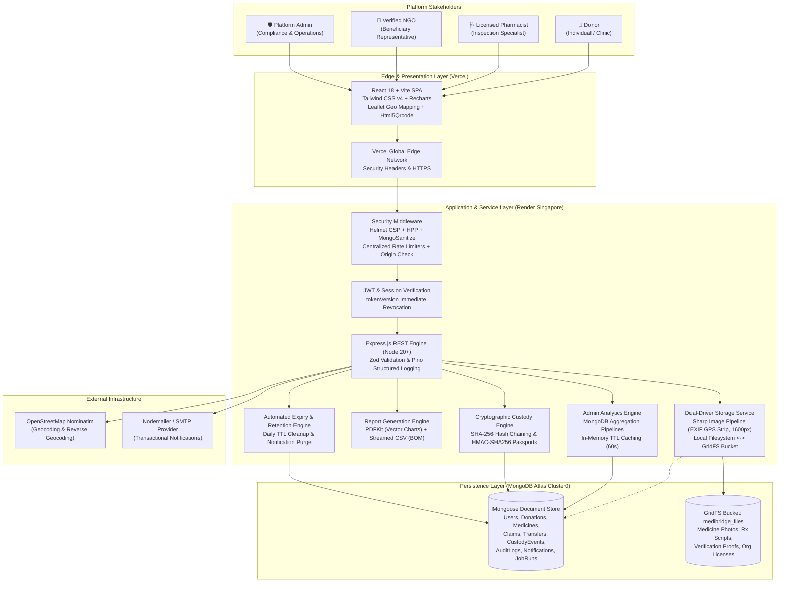
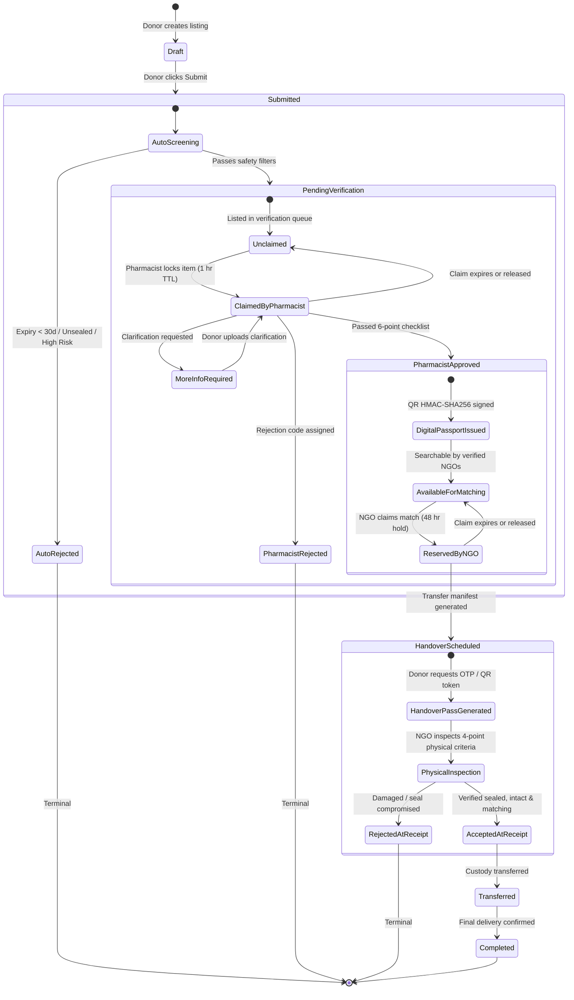
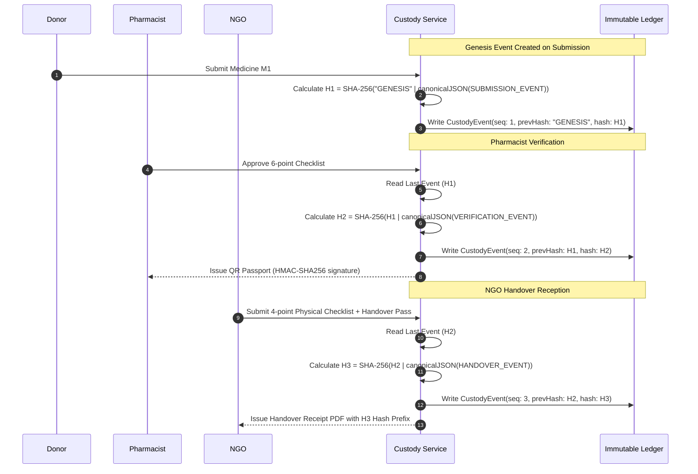
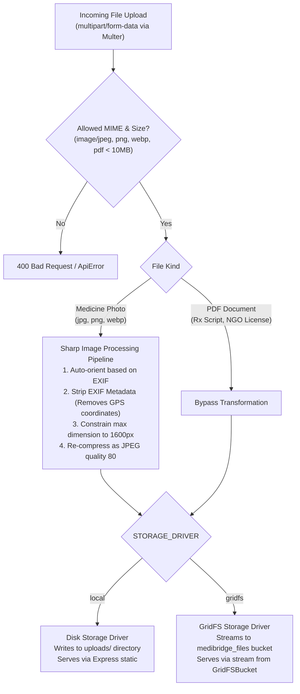

# 🏛️ MediBridge System Architecture

MediBridge is an enterprise-grade medicine donation, verification, and redistribution management platform designed with cryptographic chain of custody, role-based access control, automated expiry protection, and real-time administrative analytics.

---

## 1. High-Level System Context

---

## 2. Donation & Medicine Lifecycle State Machine

---

## 3. Cryptographic Chain of Custody & Hash Linking

Every custody event is recorded in an immutable, append-only collection (`CustodyEvent`). Each record is cryptographically linked to its predecessor via SHA-256 hash chaining:

$$H_0 = \text{"GENESIS"}$$

$$H_n = \text{SHA-256}\Big(H_{n-1} \mathbin{\Vert} \text{"|"} \mathbin{\Vert} \text{canonicalJSON}(\text{payload})\Big)$$

### Deterministic Payload Canonicalization
To guarantee identical hash evaluation across different machines, runtimes, and operating systems:
- All JSON object keys are recursively sorted in lexicographical order.
- Date instances are converted to ISO 8601 UTC strings (`YYYY-MM-DDTHH:mm:ss.sssZ`).
- Primitive types are cast to uniform string representations.
- PII (donor phone numbers, street addresses, exact coordinates) is strictly omitted prior to payload hashing.

---

## 4. Dual-Driver Storage Architecture

MediBridge abstracts file persistence behind a unified `StorageService` interface, seamlessly supporting both zero-dependency local disk storage for local development and scalable MongoDB GridFS for production deployments on Render.

---

## 5. Role Hierarchy & Access Boundaries

| Role | Permitted Actions | Privacy Boundaries & PII Redaction |
| :--- | :--- | :--- |
| **Public / Anonymous** | View landing page, verify QR passport authenticity via signed token, check system readiness (`/api/health/ready`). | No access to user directories, donations, or contact info. |
| **Donor** | Create listings, edit drafts, upload medicine photos, respond to clarification requests, view donation status, generate rolling handover pass, download medicine labels PDF. | Receives pharmacist first name & pharmacy name; never pharmacist email or phone. |
| **Pharmacist** | Browse unclaimed verification queue, lock claims (1-hr TTL), review medicine photos, request clarification, approve/reject with reason codes, view issued QR passport. | Receives donor first name, city, state, and pincode only; **phone number, email, and exact street address are strictly stripped**. |
| **NGO** | Post medicine requirements, browse geo-matched medicine pool within radius, reserve matched medicines (48-hr hold), verify handover passes, submit 4-point physical reception checklist, download handover receipts. | Receives donor contact coordinates only upon confirmed handover pass validation. |
| **Admin** | Access Executive Analytics Dashboard, inspect aggregated timeseries and funnel metrics, generate PDF/CSV audit reports, manage user accounts (suspend, reactivate, block), view system audit logs with masked IPs. | Never exposed to unmasked IP addresses, plain text passwords, or private cryptographic secrets. |
