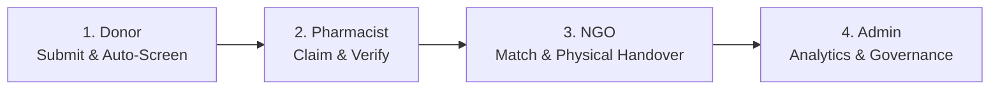

# 🎭 MediBridge Evaluator & Live Demonstration Script

This document provides a complete walkthrough for evaluators and reviewers to experience the full end-to-end lifecycle of MediBridge across its four core roles: **Donor**, **Pharmacist**, **NGO**, and **Admin**.

---

## 🌐 Live URLs & Access

- **Frontend Application**: [https://medi-bridge-taupe.vercel.app](https://medi-bridge-taupe.vercel.app)
- **Backend API**: [https://medibridge-5n0o.onrender.com](https://medibridge-5n0o.onrender.com)
- **API Readiness Check**: [https://medibridge-5n0o.onrender.com/api/health/ready](https://medibridge-5n0o.onrender.com/api/health/ready)

---

## 📋 Evaluation Walkthrough (4 Personas)

---

### Persona 1: The Donor (Medicine Submission & Screening)

1. **Sign Up / Login as Donor**:
   - Navigate to `/register` and choose the **Donor** role.
   - Enter your name, email, and password, or log in with an existing donor account.
2. **Submit a New Donation**:
   - Go to **Donate Medicines** (`/donor/donations/new`).
   - Add Item 1: `Paracetamol 500mg`, sealed strip, batch `PCM-2024`, expiry date at least 6 months in the future.
   - Upload a medicine strip photo (JPEG/PNG). Notice how Sharp automatically removes EXIF/GPS data in the background.
   - Enter your pickup location or use your browser's location.
   - Click **Submit Donation**.
3. **Verify Automated Safety Screening**:
   - View your newly submitted donation on the Donor Dashboard.
   - Note the **Auto-Screening: Passed** badge. The system confirmed expiry > 30 days, verified sealed packaging, and screened against banned drug lists.
4. **Download Printable Labels**:
   - Click **Download Medicine Labels (PDF)** to view the 2x4 printable sticker sheet with batch details and QR placeholders.

---

### Persona 2: The Licensed Pharmacist (Quality & Expiry Verification)

1. **Login as Pharmacist**:
   - Log in using a verified pharmacist account (or register as a pharmacist with license number and pharmacy name).
2. **Browse the Verification Queue**:
   - Navigate to the **Verification Queue** (`/pharmacist/queue`).
   - You will see the donation submitted in Persona 1 listed with its priority badge (`CRITICAL`, `URGENT`, `NORMAL`).
3. **Claim the Item**:
   - Click **Start Review** on the item.
   - The system locks the item with a 1-hour atomic claim TTL, preventing other pharmacists from reviewing it simultaneously.
   - Observe the donor's privacy: you see only their first name, city, and pincode; **phone number and full address are hidden**.
4. **Complete the 6-Point Inspection Checklist**:
   - Check all 6 physical and regulatory criteria:
     1. Packaging intact and sealed
     2. Expiry date clearly legible and > 30 days
     3. Batch number matches manufacturer format
     4. Storage conditions compliant (ambient room temp)
     5. No physical discoloration, dampness, or damage
     6. Genuine manufacturer labeling
   - Select **Approve** and add optional verification notes.
5. **Inspect Cryptographic QR Passport**:
   - Once approved, the system generates a cryptographically signed HMAC-SHA256 digital passport and writes an immutable `VERIFICATION_APPROVED` event to the custody ledger.
   - Click **View QR Passport** or scan the QR code to open the public verification trace.

---

### Persona 3: The Verified NGO (Geo-Matching & Handover Reception)

1. **Login as NGO**:
   - Log in using a verified NGO account (e.g., Hope Healthcare Foundation).
2. **Post a Medicine Requirement**:
   - Go to **Requirements** (`/ngo/requirements`) and create a requirement for `Paracetamol 500mg` within a 25 km radius.
3. **Discover Geo-Matched Medicines**:
   - Open **Medicine Matches** (`/ngo/matches`).
   - The geospatial matching engine automatically surfaces the verified Paracetamol item based on coordinate proximity and quantity.
4. **Claim & Reserve**:
   - Click **Request Medicine**.
   - The item enters a 48-hour reservation hold, and a scheduled transfer manifest is created.
5. **Physical Handover Execution**:
   - The Donor opens their transfer screen and clicks **Generate Handover Pass** (a rolling single-use code `HND-XXXXXX` valid for 15 minutes).
   - The NGO opens `/ngo/transfers`, inputs the handover pass code, and inspects the physical medicines.
   - Complete the **4-Point Physical Checklist** (sealed packaging, label match, visual condition, temperature compliance).
   - Click **Confirm Reception**.
6. **Download Official Handover Receipt**:
   - Click **Download Handover Receipt (PDF)**. Notice the vector-rendered manifest containing SHA-256 ledger hash prefixes for every accepted item.

---

### Persona 4: The Platform Administrator (Analytics, Security & Reports)

1. **Login as Administrator**:
   - Log in with credentials from `seedAdmin.js` (e.g., `admin@medibridge.org`).
2. **Executive Analytics Dashboard** (`/admin/analytics`):
   - **Date Range Controls**: Toggle presets (`Last 7 Days`, `Last 30 Days`, `Last 90 Days`, `Year to Date`, `All Time`) or pick custom dates.
   - **KPI Overview**: Inspect 11 executive metrics with period-over-period trend percentages (Donations, Medicines, Auto-Screening Pass Rate, Pharmacist Approval Rate, Wastage Prevented Units, Active Donors, etc.).
   - **Interactive Charts**:
     - *Activity Timeseries*: Area chart showing daily, weekly, or monthly donation and handover trends.
     - *Verification Breakdown*: Stacked bar chart comparing Approvals, Rejections, and More-Info requests.
     - *Conversion Funnel*: Step-by-step conversion from Submission -> Screening -> Verification -> Matching -> Handover.
     - *Top Rejection Reasons*: Horizontal bar chart highlighting root causes.
     - *Expiry Risk Forecast*: 12-month projection of inventory expiration.
     - *Top Donated & Requested Medicines*: Direct demand vs supply comparison.
   - **Platform Health Card**: Real-time MongoDB collection counts, unread notifications, failed logins (last 24h), and locked accounts.
3. **User Management & Instant Session Revocation** (`/admin/users`):
   - Filter users by role (`donor`, `pharmacist`, `ngo`, `admin`) and status (`active`, `suspended`, `blocked`).
   - Select a user, click **Change Status**, and choose **Suspend** with a mandatory reason (minimum 10 characters).
   - In the background, `user.tokenVersion` is incremented. If the suspended user makes another request, their session is immediately rejected with 403 Forbidden.
4. **Audit Log & Masked IP Viewer** (`/admin/audit`):
   - Filter immutable audit logs by action, actor, or date range.
   - Notice that client IP addresses have their last octet masked (e.g., `103.21.54.xxx`) for GDPR/privacy compliance.
   - Click **Export CSV** to download a sanitized, UTF-8 BOM CSV with spreadsheet injection neutralization.
5. **Compliance & Platform Reports** (`/admin/reports`):
   - Select **Platform Summary (PDF)** and click **Generate Report**.
   - Download the official A4 vector PDF featuring executive KPI tables, drawn vector trend charts, funnel conversions, and statutory compliance disclaimers.
   - Select **Donations**, **Verifications**, or **Handovers** and export as high-speed streamed CSV.
